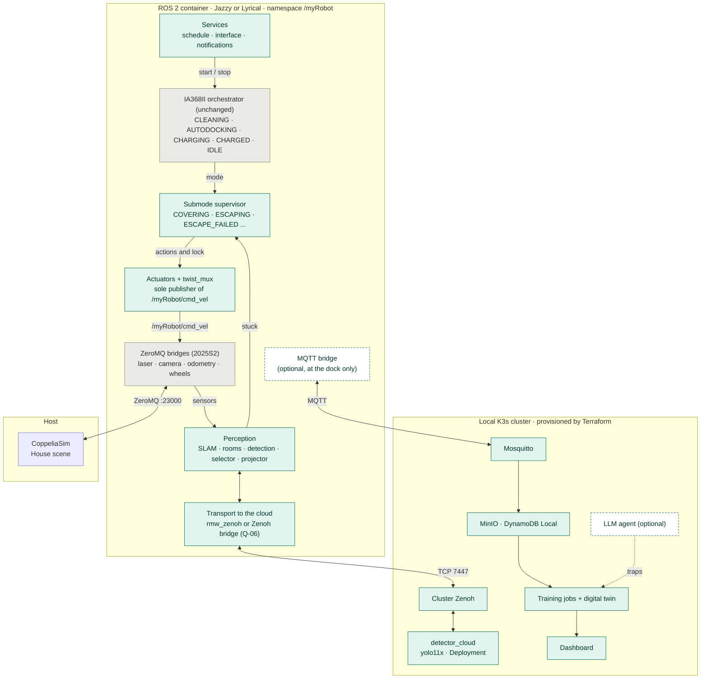
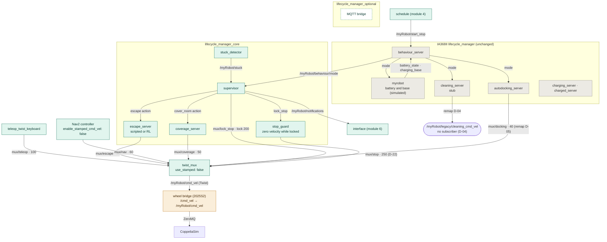
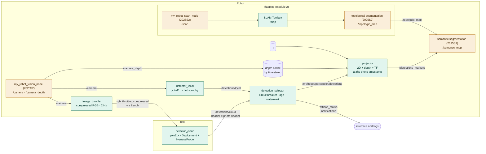
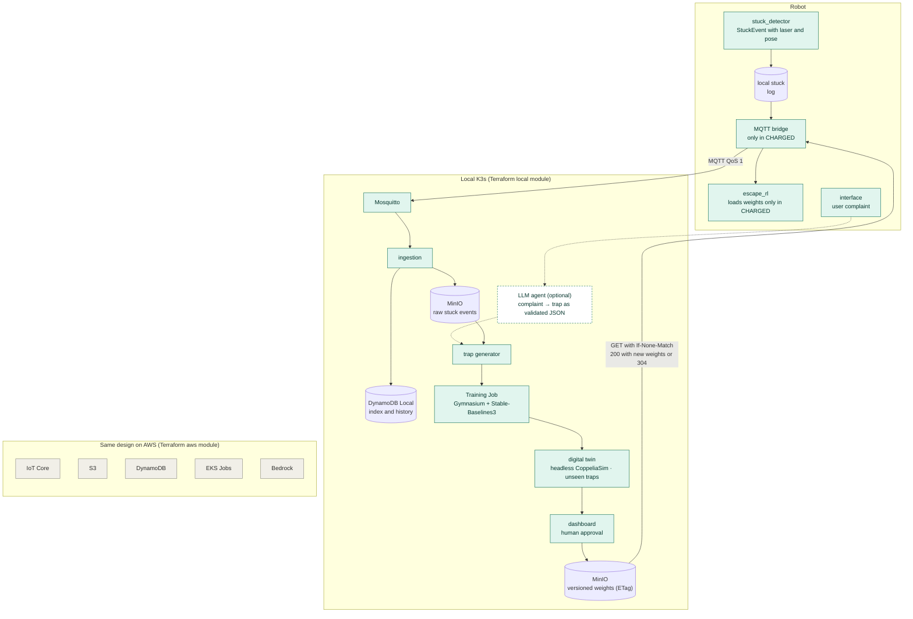
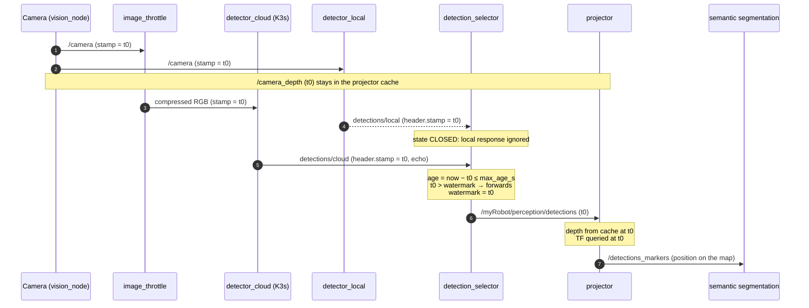
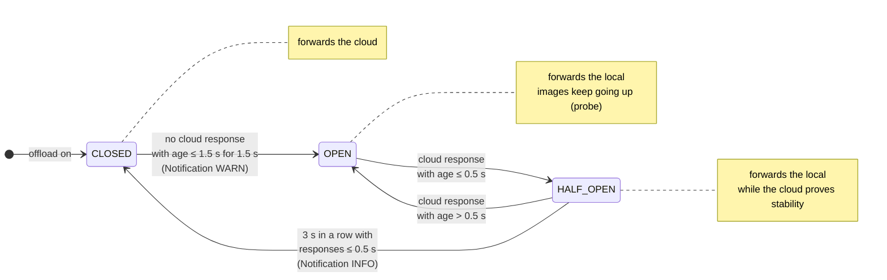
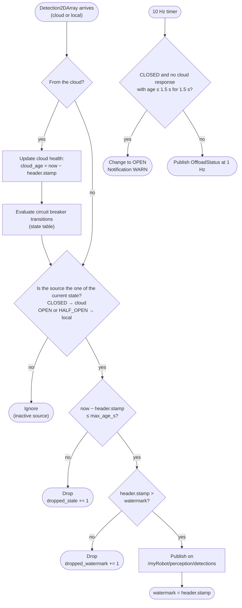
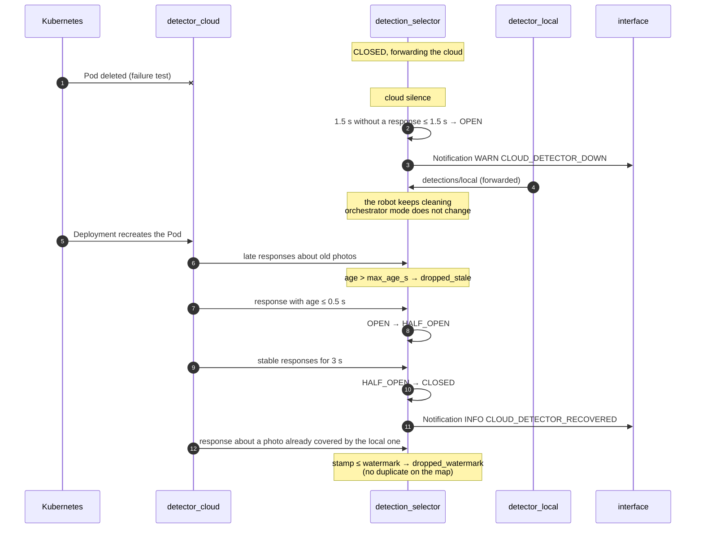
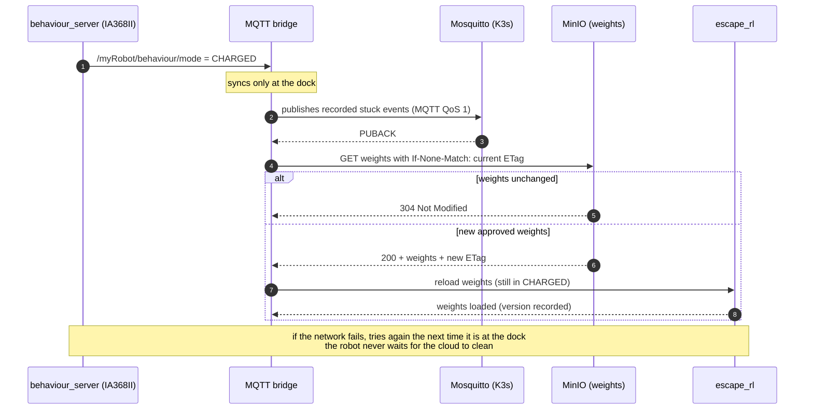

# Architecture diagrams

Source of truth: the `.mmd` files in `docs/diagrams/`. The images in `docs/diagrams/render/` are generated with:

```bash
for f in docs/diagrams/*.mmd; do mmdc -i "$f" -o "docs/diagrams/render/$(basename "${f%.mmd}").svg"; done
```

## 1. Overview

System layers: CoppeliaSim on the host, the ROS 2 container (Jazzy or Lyrical) and the K3s cluster. Grey: IA368II code, unchanged. Green: new. Dashed: optional.



## 2. Control and motion

The three lifecycle managers, the orchestrator mode, the supervisor actions and the `twist_mux` inputs with priority. Orange: reuse from the 2025S2 project.



## 3. Perception and offload

Only the compressed RGB image goes up to the cloud. Depth and TF stay on the robot, and the projector queries both at the photo timestamp (D-16).



## 4. Cloud and asynchronous cycle (spec 009b, planned)

Stuck events go up at the dock, training produces a candidate policy, the digital twin evaluates it, the dashboard approves it and the robot downloads the weights with a conditional request.



## 5. Flow: normal offload path

Timestamp echo: the photo header goes through the detector and comes back, and the robot measures the age with its own clock.



## 6. Flow: circuit breaker states

Hysteresis: opening threshold (1.5 s) different from the closing one (0.5 s held for 3 s).



## 7. Flow: selector decision per message

Filter order: active source, age, watermark. The 10 Hz timer detects cloud silence.



## 8. Flow: failure and recovery

The test that kills the Pod: circuit opening, late responses dropped by age and duplicates dropped by the watermark.



## 9. Flow: dock synchronization (spec 009b, planned)

Only in CHARGED. Stuck events go up over MQTT QoS 1 and weights come down with If-None-Match (304 when nothing changed).


