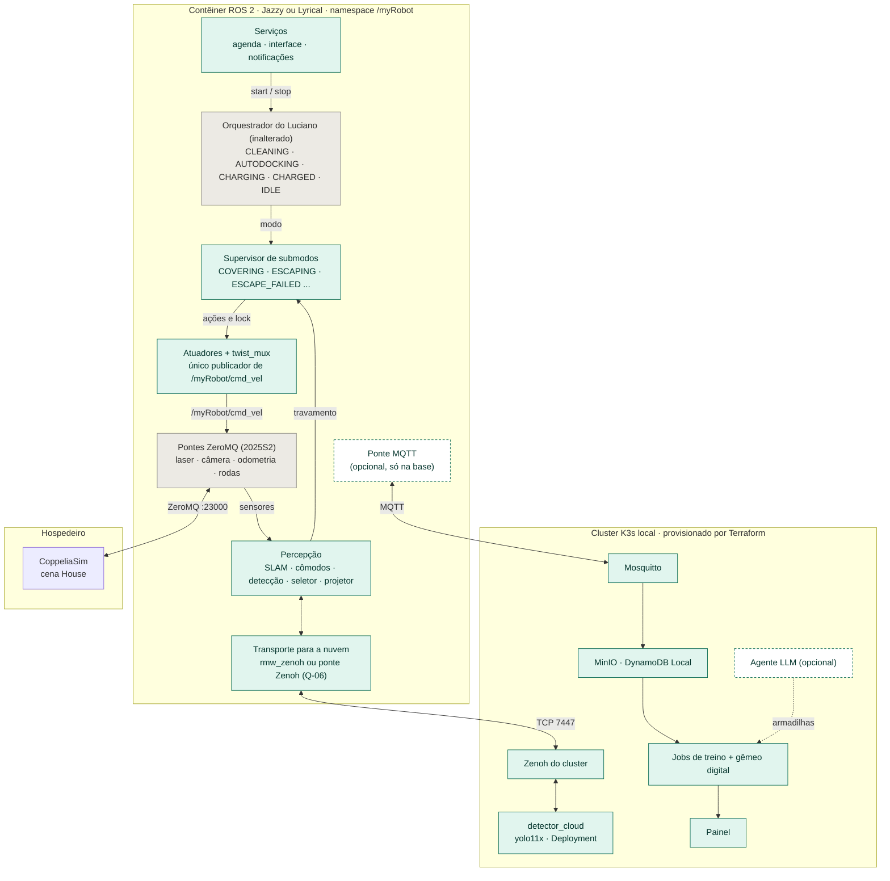
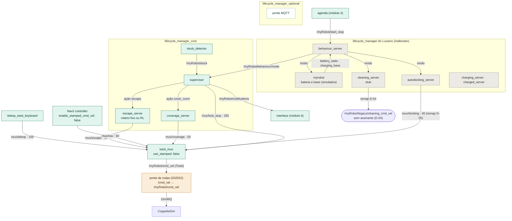
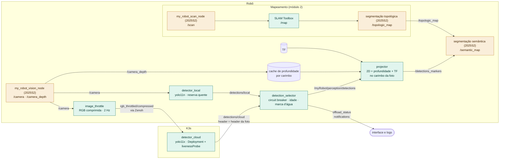
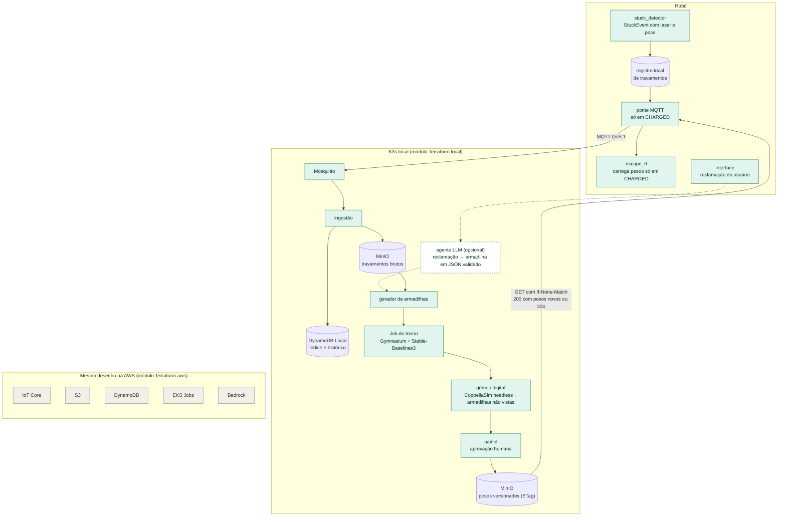
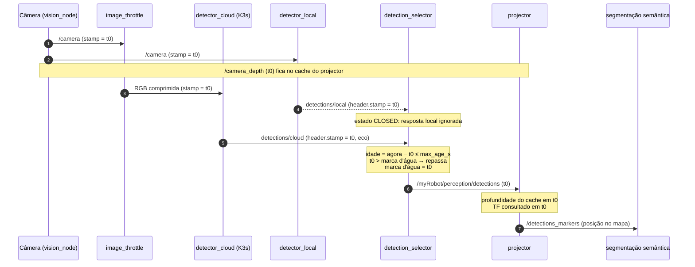
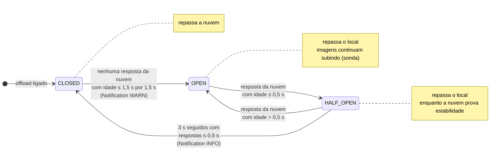
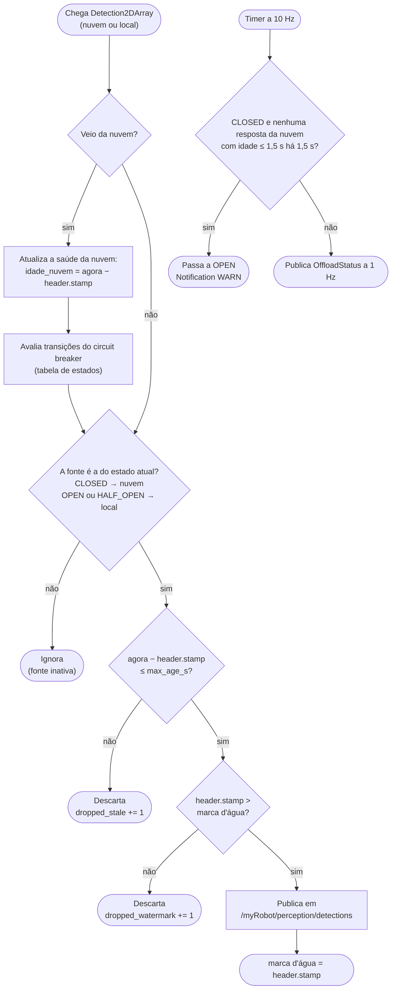
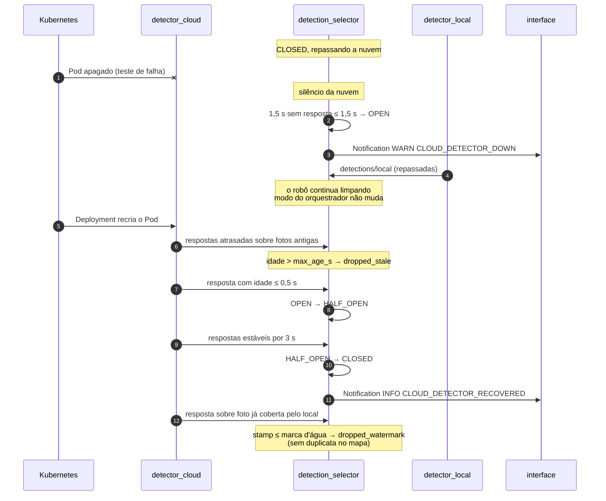
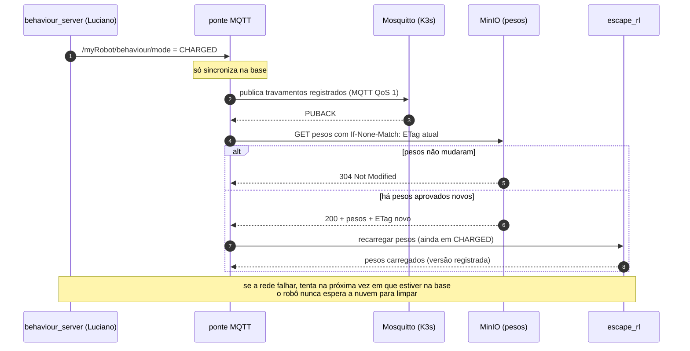

# Diagramas de arquitetura

Fonte de verdade: os arquivos `.mmd` em `docs/diagramas/`. As imagens em `docs/diagramas/render/` são geradas com:

```bash
for f in docs/diagramas/*.mmd; do mmdc -i "$f" -o "docs/diagramas/render/$(basename "${f%.mmd}").svg"; done
```

## 1. Visão geral

Camadas do sistema: CoppeliaSim no hospedeiro, o contêiner ROS 2 (Jazzy ou Lyrical) e o cluster K3s. Cinza: código do Luciano, sem alteração. Verde: novo. Tracejado: opcional.



## 2. Controle e movimento

Os três lifecycle managers, o modo do orquestrador, as ações do supervisor e as entradas do twist_mux com prioridade. Laranja: reuso do projeto 2025S2.



## 3. Percepção e offload

Só a imagem RGB comprimida sobe para a nuvem. A profundidade e o TF ficam no robô, e o projector consulta os dois no carimbo da foto (D-16).



## 4. Nuvem e ciclo assíncrono (spec 009b, planejada)

Travamentos sobem na base, o treino gera uma política candidata, o gêmeo digital avalia, o painel aprova e o robô baixa os pesos com requisição condicional.



## 5. Fluxo: caminho normal do offload

Eco do carimbo: o header da foto atravessa o detector e volta, e o robô mede a idade com o próprio relógio.



## 6. Fluxo: estados do circuit breaker

Histerese: limiar de abertura (1,5 s) diferente do de fechamento (0,5 s mantido por 3 s).



## 7. Fluxo: decisão do seletor por mensagem

Ordem dos filtros: fonte ativa, idade, marca d'água. O timer a 10 Hz detecta o silêncio da nuvem.



## 8. Fluxo: falha e recuperação

O teste que derruba o Pod: abertura do circuito, respostas atrasadas descartadas por idade e duplicatas descartadas pela marca d'água.



## 9. Fluxo: sincronização na base (spec 009b, planejada)

Só em CHARGED. Travamentos sobem por MQTT QoS 1 e pesos descem com If-None-Match (304 quando nada mudou).


