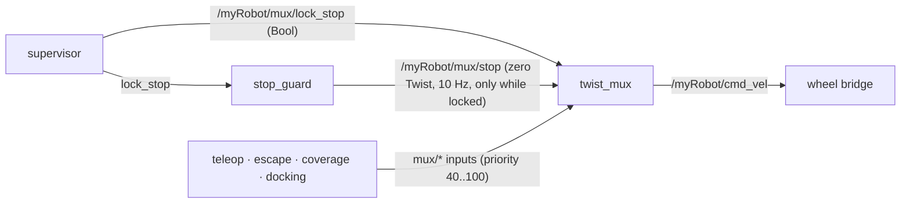

# stop_guard: zero velocity while the robot is locked

Decision **D-22** (spec 000), requirements **001-R10, 001-R19, 001-R20** (spec 001), package `src/vacuum_safety`.

## 1. The problem

The stop lock (`/myRobot/mux/lock_stop`, Art. VI) is how the supervisor stops the robot when an escape fails.
The first design relied on the lock feature of `twist_mux` to produce a zero velocity. Running the real
`twist_mux` showed it does not:

| Situation | Output of `twist_mux` on `/myRobot/cmd_vel` |
|---|---|
| Unlocked, teleop publishing `x = 0.2` | `x = 0.2` |
| **Locked**, teleop still publishing | **no message at all** |

While a lock is active, `twist_mux` simply stops forwarding. It does not publish zero. The wheel base keeps
executing the last command it received, so a "locked" robot could keep moving at `x = 0.2`.
This is the opposite of what a stop lock is for, and it is why 001-R10 ("publish zero velocity while locked")
could not be met by the mux alone.

Evidence is reproducible: `tools/probes/mux_lock_probe.sh` (check 2).

## 2. The design

A small actuator node, `stop_guard`, turns the lock into an explicit zero command that goes **through** the mux,
so `twist_mux` stays the sole publisher on `/myRobot/cmd_vel` (Art. VI.1).

Priorities (higher wins; a lock blocks every input whose priority is **lower** than the lock's):

| Element | Topic | Priority | Timeout |
|---|---|---|---|
| `stop` input (zero velocity) | `/myRobot/mux/stop` | **250** | 0.5 s |
| `stop` **lock** | `/myRobot/mux/lock_stop` | **200** | none (latched) |
| teleop | `/myRobot/mux/teleop` | 100 | 0.5 s |
| escape | `/myRobot/mux/escape` | 80 | 0.5 s |
| nav (spec 005) | `/myRobot/mux/nav` | 60 | 0.5 s |
| coverage | `/myRobot/mux/coverage` | 50 | 0.5 s |
| docking | `/myRobot/mux/docking` | 40 | 0.5 s |

Ordering rule, checked by `test_twist_mux_config.py`: `stop input (250) > lock (200) > every driving input (<= 100)`.

- While the lock is **on**, the lock silences all driving inputs (200 > 100) and `stop_guard` publishes zeros at
  10 Hz on `mux/stop` (250 > 200, so it passes the lock). The mux output is exactly zero.
- When the lock is **off**, `stop_guard` publishes nothing; the `stop` input times out after 0.5 s and the driving
  inputs take over again.

## 3. Components

| Piece | File | Role |
|---|---|---|
| `StopGuard` | `src/vacuum_safety/vacuum_safety/stop_guard_core.py` | Pure Python, no ROS (D-18). Holds the lock state; `command()` returns `(0.0, 0.0)` while locked, else `None`. The caller decides the rate (D-19). |
| `stop_guard` node | `src/vacuum_safety/vacuum_safety/stop_guard_node.py` | `LifecycleNode`. Subscribes to `lock_stop`, publishes the zero `Twist` at `publish_rate_hz` (default 10 Hz) and a `DiagnosticArray` on `/myRobot/telemetry/stop_guard` at 1 Hz (D-20). Managed by `lifecycle_manager_core`. |
| `twist_mux.yaml` | `src/vacuum_bringup/config/twist_mux.yaml` | `stop` input (250), lock (200), `use_stamped: false` (D-13). |
| Probe | `tools/probes/mux_lock_probe.sh` | Runs the **real** `twist_mux` with our config in a throwaway container and asserts five behaviours. |

## 4. Failure behaviour

| Failure | What happens | Safe? |
|---|---|---|
| Supervisor dies **while locked** | The lock is latched in `twist_mux` (timeout 0) and in `StopGuard`; zeros keep flowing. | Yes: the robot stays stopped until an explicit release. |
| Supervisor dies **while unlocked** | No lock ever arrives; normal operation. The robot is not stopped by this mechanism (out of scope; the existing input timeouts of 0.5 s apply). | Same as before. |
| `stop_guard` dies while locked | The `stop` input times out after 0.5 s and the output goes silent, but the **last command published was zero**, so the base holds zero. The lock still blocks every driving input. | Yes. |
| `stop_guard` never started | The lock alone gives silence, and the base keeps its last command. | **No.** This is why `stop_guard` is in `lifecycle_manager_core` and in the launch file (T013), and why T014 asserts zero on `/myRobot/cmd_vel`, not only silence from the inputs. |
| Message loss on `lock_stop` | The supervisor republishes the lock at 5 Hz, so a late `twist_mux` or guard recovers within 0.2 s. | Yes. |

## 5. Alternatives considered

1. **Zero from the supervisor itself.** Rejected: the supervisor is a *service* (Art. III.4), it must never
   publish motion commands.
2. **Publish zero directly on `/myRobot/cmd_vel`.** Rejected: breaks Art. VI.1 (only `twist_mux` publishes there).
3. **Patch the wheel bridge to stop on a timeout.** Rejected: the bridge is third-party code from the 2025S2
   project (Art. II). It may already have a timeout; that is still to be checked (Q-01), and even then a
   timeout is slower than an explicit zero.
4. **A single input at the highest priority, no lock.** Considered. It would work, but the lock is the contract
   (`/myRobot/mux/lock_stop`, frozen in the specs and in the supervisor), and keeping it makes the stop
   behaviour visible to the mux's own diagnostics.

## 6. Verification

| Level | Test | Requirement |
|---|---|---|
| Unit | `src/vacuum_safety/test/test_stop_guard_core.py` (6 tests) | 001-R19, D-20 |
| Node (rclpy, in-process) | `src/vacuum_safety/test/test_stop_guard_node.py` (4 tests) | 001-R19, D-20 |
| Config vs contract | `src/vacuum_bringup/test/test_twist_mux_config.py` | 001-R10, R11, R18, R20 |
| Real `twist_mux` (Docker) | `tools/probes/mux_lock_probe.sh [jazzy\|lyrical]` | 001-R10, R19, R20 |
| Whole system | `launch_testing` scenario "escape fails" (T014) | 001-R09, R10 |

Run the probe with `tools/probes/mux_lock_probe.sh jazzy`. Last result (Jazzy, `twist_mux` 4.x from apt):
all five checks `ok`. The Lyrical run is pending (T003b needs the Lyrical image / `ros-lyrical-twist-mux`).

## 7. Note on the constitution

Art. VI.2 says "a maximum-priority stop lock exists". With this design the **lock** has priority 200 and the
zero-velocity **input** has 250. The intent is preserved (the stop is the highest-priority outcome of the mux),
but the wording is now slightly off. Amending Art. VI.2 to "the stop has the maximum priority" is suggested.
